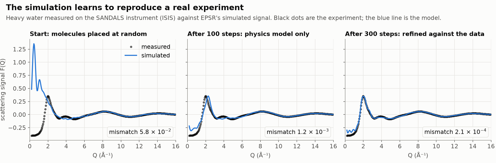
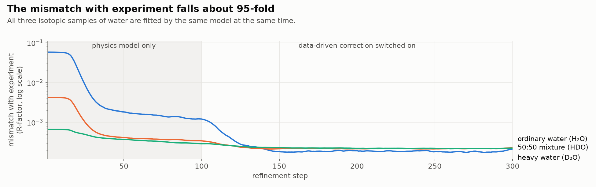
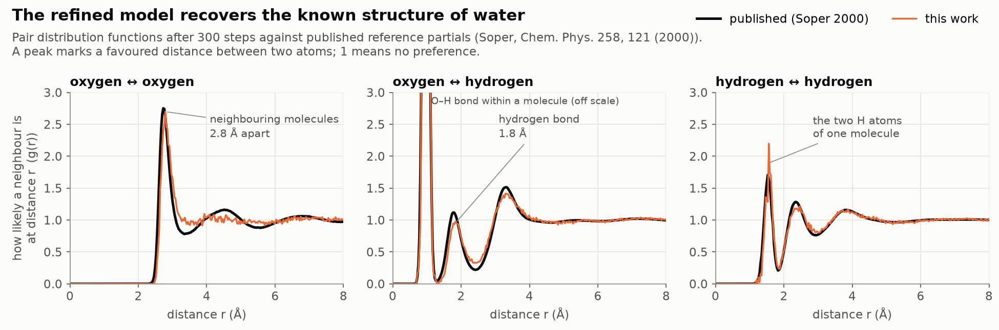
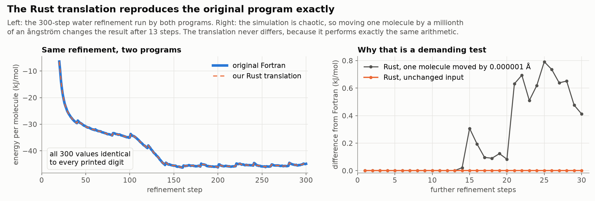

# EPSR, reinvented

**EPSR** (Empirical Potential Structure Refinement, A. K. Soper) turns neutron and X-ray diffraction data into atomistic models of liquids, glasses and disordered materials. For 30 years it has been a Fortran program run through an interactive shell. It is hard to install and hard to script, and it has no interface an agent can drive.

This repository is our entry to [**Reinvent the Wheel: A Tools for Science Hack**](https://luma.com/vdq0qw9u?tk=deOgNI) (Science Works × Inherent Laboratories, London, 16–18 October 2026). Over the weekend we rebuilt EPSR as a stack:

```
 browser ── webapp/ ── mellor/ (LLM agent) ── python/ (epsr package) ── rust/ (engine)
                │              │                       │
          accounts, jobs,   proposes the model,     epsr.vis / epsrvis
          seaborn, Overleaf  writes the report      (figures, per-iteration recording)
```

1. **A Rust translation of the whole Fortran EPSR suite**: the `epsr` engine and all 35 setup and analysis programs. It is verified **byte for byte** against the original.
2. **A Python package, `epsr`**, that drives the Rust engine in-process. It returns NumPy arrays and handles refinement loops, and its plotting comes from the `epsrvis` toolkit.
3. **Mellor**, an LLM agent that takes measured data and returns a finished, reproducible refinement with a PDF report.
4. **A web app** around Mellor: upload data, watch the run, get seaborn figures and a report, and push figures straight into an Overleaf paper.

Everything is MIT-licensed (see [LICENSE](LICENSE)).

---

## 1. The theory, in brief

A diffraction experiment on a disordered material measures the total structure factor F(Q). It is a weighted sum of the partial structure factors of every pair of atom types α, β:

$$F(Q) = \sum_{\alpha \le \beta} (2-\delta_{\alpha\beta})\, c_\alpha c_\beta\, b_\alpha b_\beta \,\big[S_{\alpha\beta}(Q) - 1\big]$$

Here c are the atomic fractions and b the scattering lengths (form factors for X-rays). Each S_αβ(Q) is the Fourier transform of a partial pair distribution function g_αβ(r). A single measurement mixes all the partials together. Isotope substitution helps: H₂O, D₂O and HDO have the same structure but different weights b, so measuring several of them gives several independent combinations of the same partials.

EPSR inverts these data with a model:

* **Monte Carlo on a reference potential.** A periodic box of molecules (thousands of atoms) is simulated with a physically sensible potential: Lennard-Jones plus Coulomb, with intramolecular geometry held by harmonic constraints.
* **An empirical potential (EP).** Every few cycles, the simulated F(Q) of each data set is compared with the measurement. The residual, D(Q) − F_sim(Q), is inverted through the weights matrix into a correction for each atom pair. That correction is added to the potential as a sum of Poisson functions in r, which pushes the simulation towards the data.
* **A cap on the EP.** The EP's total amplitude is limited by `ereq`, so the data refine the model rather than overwrite the physics. A large EP is a sign that the reference potential is poor.
* **Ensemble averages.** Once the fit stabilises, EPSR accumulates partial g(r), coordination numbers, bond angles and spatial density functions over many configurations. All of them are consistent with every data set at once.

Fit quality is given by the R-factor, the mean squared difference between data and simulation over the fitted Q range. For water refined against good neutron data it falls to a few × 10⁻⁴.

### What this looks like on real data

The figures below come from the validated water refinement in [`validation/water`](validation/water): 1000 water molecules fitted to three neutron measurements from the SANDALS instrument at ISIS. They show the method doing its job. The model starts as a random box of molecules, the simulated signal is pulled onto the measured one, and the structure that comes out is the known structure of water.



The first 100 steps use only the physics model, which gets the general shape right. Switching on the data-driven correction (the empirical potential) closes most of the remaining gap, most visibly around the main peak near Q = 2 Å⁻¹.



One model has to fit all three isotopic samples at once. That constraint is what makes the result trustworthy rather than a curve fit, and the mismatch for all three falls to about 2 × 10⁻⁴.



The refined model shows the familiar features of liquid water: neighbouring molecules 2.8 Å apart and hydrogen bonds at 1.8 Å. Its pair distribution functions closely follow the published reference partials of Soper (2000). Two caveats apply. The reference is itself derived from water diffraction data by an EPSR-type refinement, so this is a consistency check rather than an independent measurement. Our 300-step schedule is also short, which is why the oxygen–oxygen curve is still noisy between 3 and 5 Å.

Key references: Soper, *Chem. Phys.* **202**, 295 (1996); Soper, *Phys. Rev. B* **72**, 104204 (2005); Soper, *EPSRshell user's guide*, RAL-TR-2011-012. More references are in [mellor/docs/integration.md §7.3](mellor/docs/integration.md).

---

## 2. The Rust engine and how its accuracy was verified

[`rust/`](rust/README.md) translates EPSR version 26 (`fortran_src/epsr_standalone_rev3.f` and everything it calls) into about 35,000 lines of dependency-light Rust. It uses `rayon` for parallel loops. The port covers every optional engine feature: X-ray data, non-cubic boxes, tethered molecules and dihedral groups, container forces, three-body terms, coordination constraints, coarse graining, pressure control, Bragg and diffuse scattering, and lattice refinement. All 35 setup and analysis programs (`makemole`, `mixato`, `fmole`, `nwts`, `partials`, `sdf`, `sharm`, …) are ported too.

**Our standard was exact equivalence, not "close agreement".** Monte Carlo trajectories are chaotic: once any accept/reject decision comes out differently, the two runs drift apart for good. Byte-identical output after hundreds of coupled iterations is therefore a very strict test.



On the left, the Fortran and the Rust run the same 300-step water refinement and produce the same energy at every step. Every one of the 39 output files is identical too. On the right, both programs continue for 30 more steps. The Rust stays identical to the Fortran. A copy whose input differs only by moving one of the 1000 molecules by 10⁻⁶ Å (a millionth of the size of an atom) matches for 12 steps and then diverges. Nudges of 10⁻⁵ to 10⁻² Å diverge within one or two steps. (A 10⁻⁷ Å nudge, about the precision of the coordinate file, changed no Monte Carlo decision within 30 steps.) The run data and the script that draws these figures are in [docs/figures/](docs/figures/make_readme_figures.py). The original Fortran was rebuilt as a reference (gfortran `-O2 -fno-tree-vectorize`), and the two codes were compared file by file at three levels.

| level | what was compared | result |
|---|---|---|
| **Supplied test case** ([`EPSR-test/`](EPSR-test), 200 DMSO + 400 water, three neutron data sets) | every output file over 12 chained EPSR runs, plus input variants; FNV hashes of every file are pinned in `cargo test` | byte-identical |
| **115 feature tests** ([`test_problems/200DMSO400Water/EPSR-test-ex*`](rust/docs/TEST_CASES.md)) | one case per feature and per tool: X-ray data, Gaussian/Morse potentials, triclinic boxes, `ereq` control, resets, every setup and analysis program, error paths and more; 232 chained passes, each with an archived Fortran reference | byte-identical (bar the 5 deliberate bug fixes below) |
| **Real experimental data** ([`validation/`](validation/README.md)) | systems built from scratch from the Dissolve examples and refined for 300 EPSR iterations against measured data; Fortran, Rust CLI and Python wrapper run side by side, with **every file compared after every step** | all three cases: every step identical |

The three real-data systems:

| case | system | data | final R-factor |
|---|---|---|---|
| water | 1000 H₂O, 300 K | SANDALS: H₂O, D₂O, HDO | 2.3 × 10⁻⁴ (from 2.1 × 10⁻² at a random start) |
| silica | 1500 Si + 3000 O, amorphous | NIMROD | 2.3 × 10⁻⁴ |
| Cu-BTC (HKUST-1) | 624-atom MOF unit cell, with Bragg peaks | NIMROD | 1.6 × 10⁻² |

For water, the refined model has the O···H hydrogen-bond peak at 1.80 Å and the O–O peak at 2.79 Å. The overlay plots for [water](validation/water/gr_agreement.png), [silica](validation/silica_bulk/gr_agreement.png) and [Cu-BTC](validation/cu-btc/gr_agreement.png) show zero difference for every pair, because the three `.g01` files are literally the same file. We also checked that the parallel Rust gives identical output at any thread count (`tests/thread_invariance.rs`). That check also fixes a data race present in the Fortran's OpenMP code.

**Fortran bugs found along the way.** Translating line by line exposed defects in the original. [FORTRAN_BUGS.md](FORTRAN_BUGS.md) catalogues them. Five are now fixed in the Rust as documented, deliberate divergences; the largest is three-body angles being silently corrupted from cosines to radians after every save. The rest are reproduced on purpose so that the equivalence still holds, and each has a proposed fix and its blast radius. Inputs on which the Fortran crashes or reads uninitialised memory raise a clear "not supported by the Rust port" error instead.

To reproduce: [rust/docs/VALIDATION.md](rust/docs/VALIDATION.md) and [validation/README.md § How to reproduce](validation/README.md#how-to-reproduce).

---

## 3. The Python package

[`python/`](python/README.md) is a PyO3 extension built with `uv sync`. It calls the Rust engine's public API unchanged, so its output is still byte-identical to the Fortran:

```python
import epsr
project = epsr.Project.from_template("../EPSR-test", "work/dmso")
sim = project.simulation(overrides={"ntimes": 5})
summary = sim.run()                       # one EPSR run in Rust, GIL released
sim.gr_inter("O1", "H1")                  # partial g(r) as a NumPy array
history = epsr.refine(project, n_runs=20) # refinement loop with convergence history
epsr.tools.run(folder, "nwts", ["sample.NWTS.dat"])   # any of the 35 tools
```

`epsr.vis`, built on the [`visualisation/`](visualisation/README.md) toolkit `epsrvis`, records every iteration and produces convergence plots, F(Q) fits and residual maps, partials, EPs, coordination numbers, bond angles and 3D configurations. Examples 05–07 refine water and silica against the real data. The package has 222 tests.

---

## 4. Mellor: an AI agent for structure refinement

Setting up an EPSR refinement takes expertise: choosing molecules and force fields, building boxes, computing scattering weights, scheduling the reference-potential and EP stages, and reading the results. [**Mellor**](mellor/README.md) lowers that barrier. You give it Gudrun `.mint01` data files and, optionally, a sentence about the sample, and it returns a finished refinement:

1. **Inspect and propose.** A Hugging Face language model (hosted, e.g. Qwen3-235B, or local, e.g. Qwen3-4B) reads the data and proposes a *system specification* as JSON. When the sample matches one of its validated library systems (water, silica, DMSO/water, benzene, Cu-BTC), Mellor uses that system.
2. **Generate and run.** Ordinary code turns the specification into EPSR input files and a **standalone Python script**. It then runs the Rust engine through `epsr`: a scratch start, equilibration on the reference potential, then EP refinement.
3. **Analyse and report.** `epsrvis` makes the figures, the analysis gives fit quality per data set, a convergence verdict and first-shell distances and coordination numbers, and all of it goes into a PDF report.
4. **Discuss.** The model writes the discussion and answers follow-up questions. Its tools can query the results, search for comparable data (locally, the Dissolve examples, Zenodo) and launch new refinements.

**The model never produces a number.** It only proposes the specification and writes prose; every number comes from the verified engine. Every run folder contains `run_<name>.py`, which reproduces the whole calculation with only the open-source `epsr` and `epsrvis` packages and no LLM. Models outside the validated library are flagged as unvalidated in the report. A `scripted` backend runs the same pipeline with no model at all.

```bash
cd mellor && uv sync
uv run mellor run ../experimental_data/water/data/*.mint01 --out work/water \
    --backend hf-api --model Qwen/Qwen3-235B-A22B-Instruct-2507
uv run mellor chat work/water
```

Details: [mellor/docs/architecture.md](mellor/docs/architecture.md) and [mellor/docs/integration.md](mellor/docs/integration.md).

---

## 5. The web app

[`webapp/`](webapp/README.md) is a FastAPI application that puts Mellor in front of scientists who would never touch a Fortran shell:

| feature | how |
|---|---|
| **Upload data** | `.mint01` files are validated in the request, before a job is queued. The validator catches EPSR's silent traps: the 5000-point limit, data beyond `nq × qstep`, and file names with blanks. |
| **Agent runs EPSR** | one worker process per run calls `Mellor.run_pipeline`; progress is streamed live over Server-Sent Events; runs can be cancelled and survive server restarts |
| **Results** | seaborn figures drawn from Mellor's tidy CSV tables (PNG and vector PDF), the PDF report, the reproducible script and the EPSR folder; follow-up chat with the agent |
| **Publish to Overleaf** | tick figures and push them into the `figures/` folder of an Overleaf project through its Git bridge, with ready-made `\includegraphics` blocks. Without Overleaf premium, a zip plus `figures.tex` is offered instead. |
| **Accounts** | scrypt passwords, signed cookies, CSRF protection, per-user run folders as the trust boundary, Overleaf tokens encrypted at rest and never placed on a command line |
| **About and Instructions** | the theory and a user guide, at `/about` and `/instructions` |

```bash
cd webapp
uv sync --extra agent      # builds the Rust engine on first sync
uv run epsrweb             # http://127.0.0.1:8000
```

Without the agent extra the app runs in a clearly labelled **demonstration mode** with synthetic results. `/healthz` reports exactly which component is missing. The 51 tests run the HTTP layer end to end on real water data and pin every assumption the app makes about Mellor's API.

---

## Repository map

| path | contents |
|---|---|
| [`rust/`](rust/README.md) | the Rust engine (`epsr-core`), the drop-in CLI `epsr-rs`, the Fortran reference build and comparison tools, and the architecture, Fortran-map and validation docs |
| [`python/`](python/README.md) | the `epsr` Python package (PyO3), examples, tests, user guide and API reference |
| [`visualisation/`](visualisation/README.md) | the per-iteration recorder and the `epsrvis` analysis and plotting toolkit |
| [`validation/`](validation/README.md) | water, silica and Cu-BTC refined against measured data by the Fortran, the Rust CLI and the Python wrapper |
| [`mellor/`](mellor/README.md) | the LLM agent |
| [`webapp/`](webapp/README.md) | the web application around Mellor |
| [`test_problems/`](rust/docs/TEST_CASES.md) | the 115 `EPSR-test-ex*` verification cases with archived Fortran references |
| [`EPSR-test/`](EPSR-test) | the original 200 DMSO / 400 water test case |
| [`experimental_data/`](experimental_data) | the Dissolve example systems and measured neutron data |
| [`fortran_src/`](fortran_src) | the original Fortran, untouched |
| [`docs/figures/`](docs/figures/make_readme_figures.py) | the figures in this README, the script that draws them and the run data they use |
| [FORTRAN_BUGS.md](FORTRAN_BUGS.md) | bugs found in the Fortran and their status in the port |
| [PARALLELISM_PLAN.md](PARALLELISM_PLAN.md) | how the engine was parallelised without losing byte-identity |
| [DATA_ACQUISITION_FEASIBILITY.md](DATA_ACQUISITION_FEASIBILITY.md) | feasibility study for an agent that fetches reduced data from ISIS, ORNL and other facilities |

## Quick start

Requirements: a Rust toolchain (stable ≥ 1.85), a C compiler, Python ≥ 3.10 and [uv](https://docs.astral.sh/uv/).

```bash
# the engine, as a drop-in replacement for the Fortran `epsr`
cd rust && cargo build --release && cargo test --release

# the Python package: refine water against real SANDALS data
cd ../python && uv sync --all-extras
uv run python examples/05_experimental_water.py --quick

# the web app with the agent
cd ../webapp && uv sync --extra agent && uv run epsrweb
```

## Acknowledgements

EPSR is the work of Alan Soper (ISIS Neutron and Muon Source, STFC). The example systems and data come from the [Dissolve](https://www.projectdissolve.com/) project (T. G. A. Youngs). Built at Reinvent the Wheel 2026, hosted by Science Works and Inherent Laboratories.
