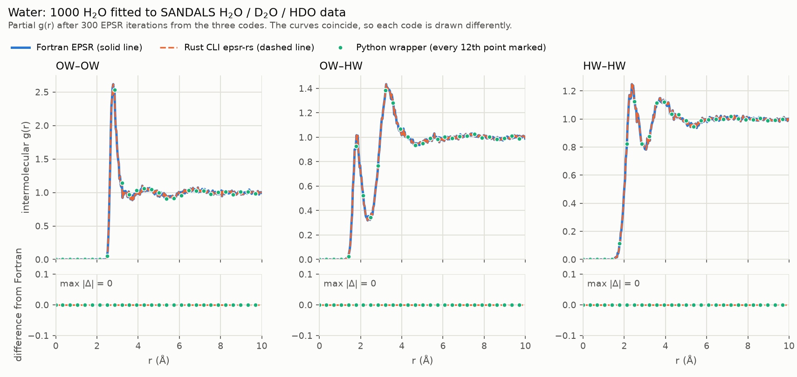
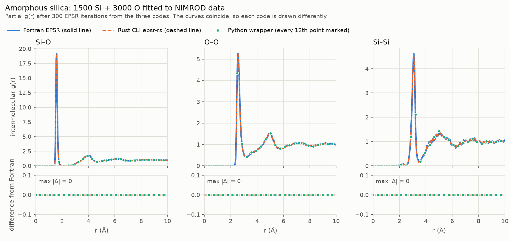
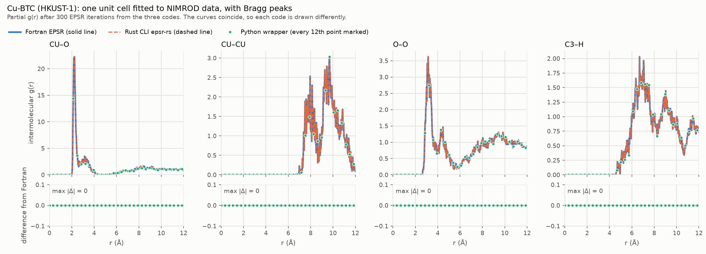

# epsr-py: Python interface to the Rust EPSR engine

`epsr` runs and inspects EPSR (Empirical Potential Structure Refinement, A. K. Soper)
from Python. The engine is the Rust translation of the original Fortran in
[`../rust`](../rust), used unchanged through its public API; it reproduces the
Fortran output byte for byte.

## Install

You need a Rust toolchain (stable, 1.85 or later), Python 3.10 or later and
[uv](https://docs.astral.sh/uv/).

```bash
curl -LsSf https://astral.sh/uv/install.sh | sh        # if uv is not installed
export PATH="$HOME/.local/bin:$HOME/.cargo/bin:$PATH"
cd python
uv sync --all-extras        # creates .venv, compiles the Rust engine, installs epsr
```

`uv sync` rebuilds the extension whenever the Rust engine or the bindings change.
The extras are `plot` (matplotlib), `pandas` and `progress` (tqdm).

## Run

One EPSR run on a copy of a simulation folder:

```python
import epsr

project = epsr.Project.from_template("../EPSR-test", "work/dmso")  # copy: EPSR rewrites its inputs
simulation = project.simulation(overrides={"ntimes": 5})           # read .EPSR.inp, .ato, .pcof, data
summary = simulation.run()                                         # one EPSR run (Rust, GIL released)

summary.r_factor                           # fit quality
simulation.gr_inter("O1", "H1")            # partial g(r) as a float32 numpy array
simulation.potential.empirical()           # (n_pairs, nr) empirical potential, kJ/mol
history = epsr.refine(project, n_runs=20)  # repeated runs with a convergence history
```

Every run overwrites `.ato`, `.pcof`, `.EPSR.inp` and `.EPSR.inpa` and appends to
`.erg`; that is how EPSR carries its state from run to run. The 35 setup and
analysis programs run as `epsr.tools.run(folder, "nwts", ["sample.NWTS.dat"])`.

| command | purpose |
|---|---|
| `uv run python examples/05_experimental_water.py --quick` | refine water against real data (about 30 s) |
| `uv run pytest -n auto` | the test suite (217 tests, about 5 minutes on 4 cores) |
| `uv run pytest -m "not slow"` | the quick tests (about 1 minute) |
| `uv run isort . && uv run black . && uv run ruff check . && uv run mypy` | format, lint, type-check |

## Examples on real experimental data

Three systems from the Dissolve examples in [`../experimental_data`](../experimental_data)
are built from scratch and refined against measured neutron data. Each has been run
by the original Fortran EPSR, by the Rust CLI and by this wrapper, and every output
file of the three is byte-identical; the plots below overlay their partial g(r).

### Water: 1000 H₂O against SANDALS H₂O, D₂O and HDO data

```bash
uv run python examples/05_experimental_water.py            # full schedule, about 4 minutes
uv run python examples/05_experimental_water.py --quick    # 10 iterations per run, about 30 s
```

The core of [examples/05_experimental_water.py](examples/05_experimental_water.py):

```python
work = Path("work/water")
epsr.copy_folder("../validation/water", work, overwrite=True)        # setup inputs
for data_file in Path("../experimental_data/water/data").glob("*.mint01"):
    shutil.copy2(data_file, work / data_file.name)                  # measured data

tools.run(work, "makemole", ["Water"])                              # molecule template
tools.run(work, "mixato", answers=["1", "Water", "1000", "0.1", "waterbox"])  # the box
tools.run(work, "randomise", ["waterbox"])
(work / "Water.mol").unlink()  # fmole refuses to run while the .mol is present
tools.run(work, "fmole", ["waterbox", "100"])                       # relax the geometry
for sample in ("H2O", "D2O", "HDO"):
    tools.nwts(work, f"{sample}.NWTS.dat")                          # neutron weights

project = epsr.Project(work, "waterbox.EPSR.inp")
project.simulation().run()                                          # scratch start
project.simulation(overrides={"niter": 99}).run()                   # reference potential only
history = epsr.refine(project, n_runs=2, overrides={"niter": 100},
                      initial_overrides={"ereq": 3.0})              # empirical potential on
```

After the full schedule the R-factor falls from 6.1×10⁻⁴ (reference potential) to
2.3×10⁻⁴, with the O···H hydrogen-bond peak at 1.80 Å and the O–O peak at 2.79 Å.



### Amorphous silica against NIMROD data

1500 Si + 3000 O at 0.0664 atoms/ų, built with `mixato` and refined with `ereq` 50.
Inputs in [`../validation/silica_bulk`](../validation/silica_bulk); it runs as a test:

```bash
uv run pytest tests/test_experimental_data.py -k silica
```



### Cu-BTC (HKUST-1), a crystal with Bragg peaks, against NIMROD data

One 624-atom unit cell of the metal-organic framework, converted from the Dissolve
input to a PDB file, read with `readpdb`, given the Dissolve force field with
`changeato`, and refined with Bragg peaks up to 5 Å⁻¹. Inputs and the conversion
notes are in [`../validation/cu-btc`](../validation/cu-btc); it runs as a test that
compares every file with the archived Fortran results after every EPSR run:

```bash
uv run pytest tests/test_cu_btc.py
```



## More

* [docs/user_guide.md](docs/user_guide.md): the workflow, overrides, perturbing the potential, tools, parallel runs.
* [docs/api.md](docs/api.md): every public class and function.
* [docs/architecture.md](docs/architecture.md) and [docs/testing.md](docs/testing.md): how the wrapper is built and verified.
* [examples/](examples): `01` to `04` show a single run, a refinement loop, potential perturbation and the tools on the DMSO/water test case.
